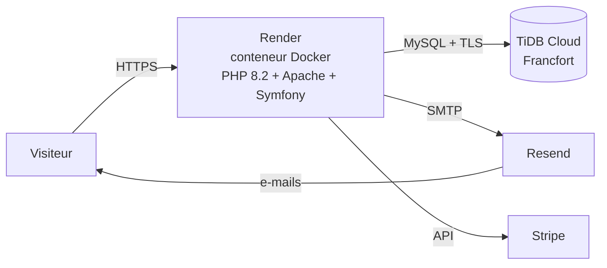

# 🎮 Cloud Quizz

**Cloud Quizz** est une application web de **quiz de culture générale** avec **forums communautaires** et **boutique en ligne**. Chaque quiz dispose de son propre espace de discussion, et la boutique permet d'acheter des contenus supplémentaires via un paiement Stripe.

🔗 **Site en ligne : https://cloud-quizz.herve-ngoma.dev**

> Projet de démonstration : seul le thème **Géographie** (quiz *Capitales* et *Drapeaux*) est jouable. Les autres thèmes s'affichent comme « indisponibles » tant qu'ils ne contiennent aucune question.
> Le paiement fonctionne en **mode test Stripe** : utilisez la carte `4242 4242 4242 4242`, une date d'expiration future et n'importe quel code.
> L'instance gratuite de l'hébergeur se met en veille : le premier chargement peut prendre jusqu'à une minute.

---

## 🚀 Fonctionnalités

- **Quiz interactifs** : 2, 3 ou 4 réponses par question, avec ou sans images (drapeaux), retour visuel immédiat (vert = bonne réponse, rouge = erreur) et score final
- **Réponses vérifiées par le serveur** : la bonne réponse n'est jamais envoyée au navigateur avant que le joueur ait répondu ; les images des choix sont servies sous une adresse neutre pour ne pas trahir la réponse
- **Disponibilité automatique** : un thème ou un quiz sans question jouable affiche un bouton « indisponible »
- **Forum par quiz** : commentaires et réponses, modérés par les rôles Modérateur et Administrateur
- **Boutique et panier**, **paiement Stripe Checkout** avec vérification côté serveur (session payée, par le bon utilisateur, pour le bon montant, une seule fois)
- **Historique des commandes** : lignes de commande avec quantité, titre et prix figés au moment de l'achat
- **Comptes utilisateurs** : inscription avec vérification de l'e-mail, connexion, profil, réinitialisation du mot de passe par e-mail
- **Rôles hiérarchisés** : utilisateur → premium → modérateur → administrateur
- **Back-office** : gestion des thèmes, quiz, questions et choix, produits, commandes et utilisateurs
- **Mode maintenance** via un listener dédié

---

## 🛠️ Stack technique

| Domaine | Technologies |
|---|---|
| Backend | Symfony 6.4 LTS, PHP 8.2 |
| Base de données | MySQL 8 en local, **TiDB Cloud** (compatible MySQL, connexion TLS) en production |
| ORM | Doctrine ORM, Doctrine Migrations |
| Vues | Twig, Bootstrap 5 |
| Front | JavaScript natif (Fetch API) pour le déroulement des quiz |
| Paiement | Stripe Checkout (`stripe/stripe-php`) |
| E-mails | Symfony Mailer + **Resend** (SMTP) |
| Sécurité | Symfony Security (authenticator personnalisé), SymfonyCasts Reset Password et Verify Email |
| Pagination | KnpPaginatorBundle |
| Déploiement | **Docker** (PHP 8.2 + Apache) sur **Render** |
| Qualité | PHPStan, PHP-CS-Fixer |

---

## 🏗️ Architecture de production



| Élément | Rôle |
|---|---|
| Domaine `cloud-quizz.herve-ngoma.dev` | CNAME vers Render, certificat HTTPS automatique |
| Render (offre gratuite) | construit l'image Docker à chaque `git push` sur `main`, puis la démarre |
| TiDB Cloud Starter | base de données ; l'application s'y connecte avec un utilisateur limité à `SELECT, INSERT, UPDATE, DELETE` |
| Resend | envoi des e-mails depuis le domaine `herve-ngoma.dev` |

---

## 📁 Structure du projet

```
Cloud_Quizz/
├── config/                      # Configuration Symfony (services, sécurité, packages)
│   └── packages/prod/           # Réglages propres à la production (TLS vers la base)
├── docker/apache.conf           # Site Apache utilisé dans l'image Docker
├── Dockerfile                   # Image de production
├── migrations/                  # Migrations Doctrine (structure de la base)
├── public/
│   ├── css/, images/            # Styles, images des thèmes et drapeaux (SVG)
│   ├── javascript/quizz.js      # Déroulement des quiz (Fetch API)
│   └── index.php                # Point d'entrée
├── src/
│   ├── Classes/Panier.php       # Panier en session
│   ├── Command/                 # Commande app:demo:geographie (quiz de démonstration)
│   ├── Controller/              # Pages, quiz, forum, panier, paiement, comptes, Admin/, Moderator/
│   ├── Entity/                  # Entités Doctrine (Choix, LigneCommande, QuestionQuizz…)
│   ├── EventListener/           # Mode maintenance
│   ├── Form/                    # Formulaires
│   ├── Repository/              # Requêtes Doctrine
│   └── Security/                # Authenticator et vérification d'e-mail
└── templates/                   # Vues Twig
```

---

## ⚙️ Installation locale

### Prérequis

- PHP 8.2 ou plus, avec les extensions `pdo_mysql` et `intl`
- [Composer](https://getcomposer.org/)
- MySQL 8 (WAMP, MAMP, Docker…)
- [Symfony CLI](https://symfony.com/download) (recommandé)

### Étapes

```bash
git clone https://github.com/HNGA91/Cloud_Quizz.git
cd Cloud_Quizz
composer install

# Variables locales (fichier non versionné), voir le tableau ci-dessous
cp .env .env.local

php bin/console doctrine:database:create
php bin/console doctrine:migrations:migrate

# Quiz de démonstration Géographie (Capitales et Drapeaux)
php bin/console app:demo:geographie

symfony serve
```

### Variables d'environnement

Les valeurs sensibles ne sont **jamais versionnées** : elles vont dans `.env.local` en local, et dans les variables d'environnement de l'hébergeur en production.

| Variable | Rôle |
|---|---|
| `APP_ENV`, `APP_SECRET` | environnement (`dev` / `prod`) et secret de l'application |
| `DATABASE_URL` | connexion à la base MySQL / TiDB |
| `MYSQL_SSL_CA` | certificat d'autorité pour le TLS vers la base (production) |
| `TRUSTED_PROXIES` | `127.0.0.1` en local, `REMOTE_ADDR` derrière le proxy de Render |
| `RESEND_API_KEY` | clé d'envoi des e-mails (`MAILER_DSN` est construit à partir d'elle) |
| `EMAIL_FROM`, `EMAIL_USER` | expéditeur des e-mails et destinataire du formulaire de contact |
| `STRIPE_SECRET_KEY` | clé secrète Stripe (mode test) |

---

## 🚢 Déploiement

Chaque `git push` sur `main` déclenche sur Render la construction de l'image Docker (`composer install --no-dev`, autoloader optimisé, préchauffage du cache) puis son démarrage.

Les **migrations** ne sont pas lancées par le conteneur : l'offre gratuite de Render ne donne pas accès à un terminal. Elles sont exécutées depuis un poste de développement connecté directement à TiDB, dans un terminal dédié :

```powershell
$mdp = Read-Host "Mot de passe administrateur TiDB"
$env:APP_ENV = "prod"
$env:DATABASE_URL = "mysql://UTILISATEUR:" + [uri]::EscapeDataString($mdp) + "@HOTE:4000/cloud_quizz?serverVersion=8.0.11&charset=utf8mb4"
$env:MYSQL_SSL_CA = "C:\chemin\vers\isrgrootx1.pem"
php bin/console doctrine:migrations:migrate
exit
```

Principe appliqué : **la structure va du développement vers la production, les données jamais**. La structure passe par les migrations, les données de démonstration par la commande `app:demo:geographie`, et les données réelles naissent en production.

---

## 🔐 Sécurité

- Contenus saisis par les utilisateurs affichés en texte brut, échappé par Twig (aucun HTML accepté) : protection contre le XSS stocké
- Paiement validé uniquement à partir de la session Stripe récupérée côté serveur, jamais à partir de ce qu'envoie le navigateur
- Back-office et espace « Mon compte » protégés par rôle (`access_control`)
- Utilisateur de base de données de l'application limité aux opérations sur les données (principe du moindre privilège)
- Connexion à la base chiffrée (TLS avec vérification du certificat)
- Secrets uniquement dans les variables d'environnement

---

## 🧪 Qualité

```bash
vendor/bin/phpstan analyse
vendor/bin/php-cs-fixer fix --dry-run
```

---

## License

© 2026 Louis-Hervé N'Goma — Tous droits réservés.

Ce projet est publié à titre de démonstration dans le cadre de mon portfolio. Le code peut être consulté librement, mais aucune réutilisation, modification ou distribution n'est autorisée sans mon accord écrit. Voir le fichier [LICENSE](./LICENSE) pour plus de détails.

Les drapeaux proviennent du projet [flag-icons](https://github.com/lipis/flag-icons) (licence MIT, voir `public/images/jeux/geographie/drapeaux/LICENSE-flag-icons.txt`).

---

## Auteur

**Louis-Hervé N'Goma** — Développeur Full Stack
GitHub : [@HNGA91](https://github.com/HNGA91)
